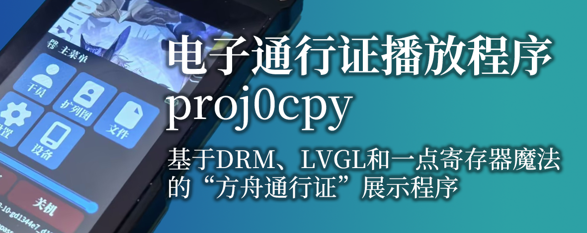
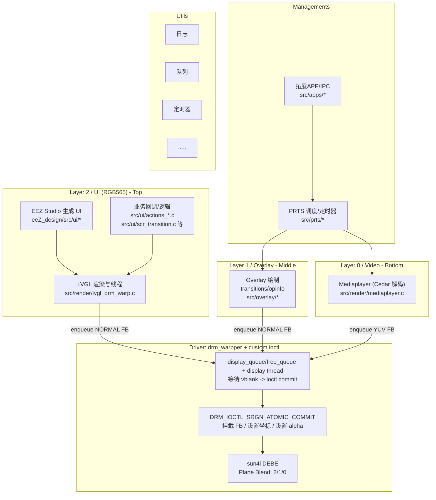

# 电子通行证播放器程序 Proj0cpy

基于DRM、LVGL和一点寄存器魔法的“方舟通行证”展示程序



## 开始使用

### 电源键和触摸输入

电源键（Linux `KEY_0`，SDL `End`）在播放态单击打开菜单，在其他页面单击返回播放态；双击打开扩列图，按住 1.5 秒打开关机确认。
双击窗口为第一次松开后350 ms；单击等待窗口结束再执行，避免双击时先切换页面。第二次按住达到1.5秒仍打开关机确认。
关机框只接受真实 CH32 触摸下滑或物理按键3（SDL `Enter`）确认，以及新一次电源键按下取消；其他输入全部忽略。
进入前已经按住的键或触摸必须先释放。关机入口统一显示对应设备的操作提示。

播放态（spinner）忽略触摸滑动、轻触和长按，不再通过触摸打开干员列表、扩列图或菜单；原按钮快捷方式保留。
其他页面 CH32 触摸按距离连续导航，轻触确认，长按返回；干员列表上长按拎起当前项，继续滑动移动，轻触落位保存，排序中再次长按也会保存退出。
原按钮路径仍为按键1/2导航、3确认/长按排序、4返回。离开列表时保存正在调整的顺序。

触摸驱动须提供 `BTN_TOUCH`、`ABS_X` 和 `ABS_MISC`，后者 bit0=位置有效、bit1=多点、bit2=取消。
正常松手可以没有有效位置标志；异常释放、多点、丢帧、断连和动画期间输入会丢弃整次手势。
按设备名 `CH32 touch slider` 与能力识别，每秒重新发现设备，不依赖 event 编号；旧驱动缺少状态扩展时禁用触摸，不影响按钮。
默认 X 增大对应下滑/下一项，反向安装可设置 `EPASS_TOUCH_INVERT=1`。

导航每 160/1023 距离一步；轻触 30～350 ms、偏移小于32；长按600 ms。
关机下滑须净位移至少256、反向累计不超过32，正常松手后才确认。

手势回放测试（不需要实板）：

```sh
cc -std=c11 -Wall -Wextra -Werror -Isrc tests/test_input_gestures.c src/driver/input_gestures.c -o /tmp/epass-input-test
/tmp/epass-input-test
```

实板仍须核验 PG10 上拉/电平、实际滑动方向和关机流程。构建与回放通过不代表已完成实板验证。

播放程序与电子通行证固件一起分发，可在[https://github.com/rhodesepass/buildroot/releases](https://github.com/rhodesepass/buildroot/releases)下载最新固件。

## 编译方法

### 直接编译

需要提前准备的其他源码：

* 本项目的buildroot https://github.com/rhodesepass/buildroot

构建:

1. 拉取上文提到的buildroot,按repo中readme编译一次 编译工具链及依赖库
2. 运行source ./output/host/environment-setup 将生成的工具链和依赖设置为默认工具链和依赖
3. 在本repo目录下:
```bash
mkdir build
cd build
cmake .. # 以release模式编译，或
cmake -DCMAKE_BUILD_TYPE=Debug .. # 以debug模式编译
make
```

若正常则终端显示此日志且build目录中出现epass_drm_app二进制文件

```
[100%] Built target epass_drm_app
```

### 跟随buildroot一起生成

直接拉取上文提到的buildroot,按repo中readme编译一次，生成的镜像里就有了。编译目录在output/build/epass_drm_app-xxxxx/下

## 开发指引

* [程序结构](docs/application_structure.md)
* [overlay层开发指南](docs/overlay_dev_note.md)

## 直接嵌入的开源代码

* [log](https://github.com/rxi/log.c) A minimal but powerful logging facility for C.
* [stb](https://github.com/nothings/stb) single-file public domain libraries for C/C++
* [code128](https://github.com/fhunleth/code128) barcode generator
* [lvgl](https://github.com/lvgl/lvgl) Embedded graphics library to create beautiful UIs for any MCU, MPU and display type.
* [cJSON](https://github.com/DaveGamble/cJSON) Ultralightweight JSON parser in ANSI C
